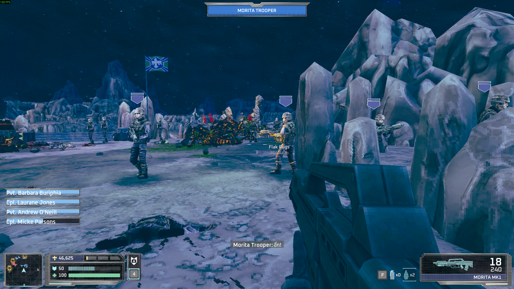
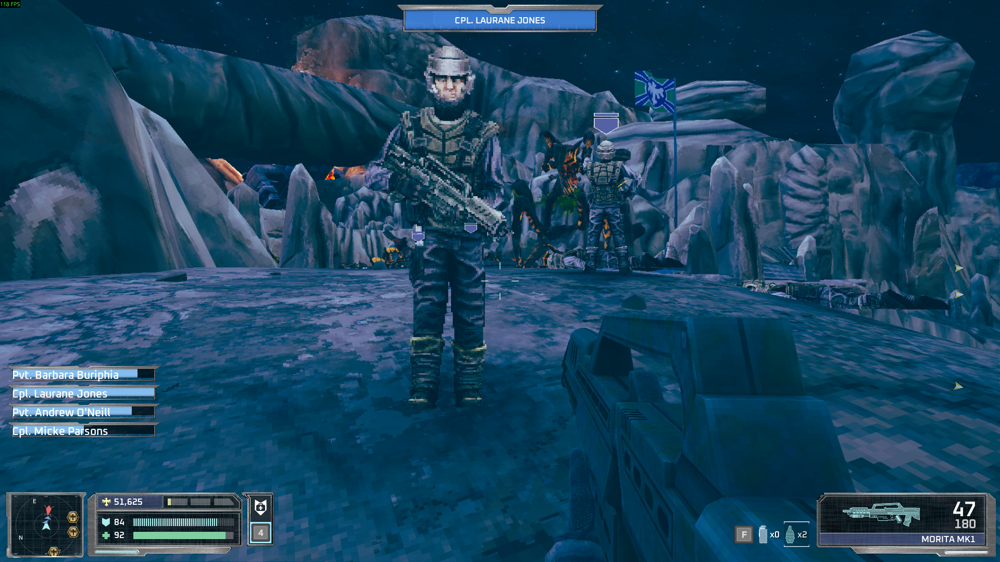

# Squad Status HUD

See who is in your squad and how much health they have, without aiming at each trooper.
A standalone HUD mod for **Starship Troopers: Ultimate Bug War!** by **NEXara**.

- Actual squad members, with their in-game names.
- Live blue health bars using the game's native HUD styling.
- A compact roster above the minimap; no numeric HP clutter.
- Hides in menus and when no squad is present.
- Display only: no changes to health, damage or squad membership.

## Downloads and installation

**Full Setup (GitHub):** includes the required UE4SS loader. Extract the release ZIP,
open `Squad-Status-HUD-Setup.exe`, select the game folder and click **Install / Update**.
Close the game before installing, updating or uninstalling.
English is the default, with an optional Thai interface using the small **EN / ไทย** button.

**Nexus English package:** manual installation, containing this mod's Lua scripts only.
Install UE4SS separately, then copy the included `ue4ss` folder into
`StarshipTroopers_UBW/Binaries/Win64`. See [manual instructions](docs/INSTALL-NEXUS.txt).

Requires Windows 10/11 and Steam build **22832378**. Full Setup requires .NET Framework 4.8.
Tested loader: UE4SS **v4.0.0-6-gef15eba8**. Verified visually at 1920×1080;
other resolutions and mod combinations may need adjustment.

## Configuration and removal

Edit `ue4ss/Mods/SquadStatusHUD/Scripts/config.lua` to adjust `Left`, `Bottom`, or `Scale`.
Restart the game after changes. Full Setup has an **Uninstall** button; for a manual
installation, remove only `ue4ss/Mods/SquadStatusHUD`. Keep a shared loader used by other mods.

## Also by NEXara

The screenshots also use the separate Thai translation mod. It is optional:
[Thai translation on GitHub](https://github.com/NEXara/Starship-Troopers-Ultimate-Bug-War-Thai)
· [Thai translation on Nexus Mods](https://www.nexusmods.com/starshiptroopersultimatebugwar/mods/14).

## Credits

Made with AI by NEXara. UE4SS by the UE4SS-RE team and contributors (MIT).
Native game assets are referenced at runtime and are not included in the downloads.
See [credits](CREDITS.txt). Independent community mod, not affiliated with the game's creators.

Release **1.0.0** · Updated **15 November 2026 (15/11/2026)**.
