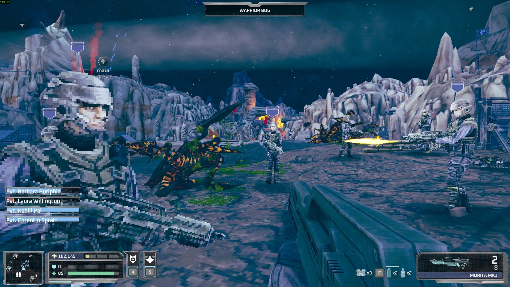

# Squad Status HUD

See who is in your squad and how much health they have, without aiming at each trooper.
A standalone HUD mod for **Starship Troopers: Ultimate Bug War!** by **NEXara**.

- Actual squad members, with their in-game names.
- Health bars using the game's native HUD styling: blue normally, red at 30% health or less.
- A slow pulse at 15% health or less.
- Join and death notices with subtle animations, included as part of the HUD.
- A compact roster above the minimap; no numeric HP clutter.
- Hides in menus and when no squad is present.
- Display only: no changes to health, damage or squad membership.

## Installation

1. Download **[Squad-Status-HUD-1.1.0-Full.zip](https://github.com/NEXara/Starship-Troopers-Squad-Status-HUD/releases/download/v1.1.0/Squad-Status-HUD-1.1.0-Full.zip)** and extract it.
2. Close the game, then open **Squad-Status-HUD-1.1.0-Setup.exe**.
3. Select the game's main folder. In Steam, right-click the game → **Manage → Browse local files** to find it. Choose the folder containing **StarshipTroopers_UBW.exe**.
4. Click **Install / Update**.
5. Start the game as usual, load a mission and recruit some troopers. Their names and health will appear above the minimap.

For example, your game folder might be:
`N:\SteamLibrary\steamapps\common\StarshipTroopers_UltimateBugWar`
Your drive and folder location may be different.

The installer includes UE4SS, so you don't need to set it up yourself.
English is selected by default. Use the **EN / ไทย** button if you prefer Thai.

Requires Windows 10/11, .NET Framework 4.8 and Steam build **22832378**.
Tested with UE4SS **v4.0.0-6-gef15eba8** at 1920×1080. You may need to adjust the
position or scale at other resolutions.

You can also find the mod on [Nexus Mods](https://www.nexusmods.com/starshiptroopersultimatebugwar/mods/15).
Follow the installation steps on that page if you download it there.

## Configuration and removal

Edit `ue4ss/Mods/SquadStatusHUD/Scripts/config.lua` to adjust `Left`, `Bottom`, or `Scale`.
You can also adjust `LowHealthThreshold`, `AlertDuration` and `MaxAlerts`.
Restart the game after saving your changes.

To remove the mod, close the game and click **Uninstall** in the installer.
If you installed it by copying files yourself, remove `ue4ss/Mods/SquadStatusHUD`.
Keep UE4SS if you use it for other mods.

## Also by NEXara

The screenshots also use the separate Thai translation mod. It is optional:
[Thai translation on GitHub](https://github.com/NEXara/Starship-Troopers-Ultimate-Bug-War-Thai)
· [Thai translation on Nexus Mods](https://www.nexusmods.com/starshiptroopersultimatebugwar/mods/14).

## Credits

Made with AI by NEXara. UE4SS by the UE4SS-RE team and contributors (MIT).
Native game assets are referenced at runtime and are not included in the downloads.
See [credits](CREDITS.txt). Independent community mod, not affiliated with the game's creators.

Release **1.1.0** · Updated **16 November 2026 (16/11/2026)**.
